# Workbench run on real data

Five actions were run through `workbench/analyze.py`: guard walk and guard idle (both rejected), Ren
4-pose walk (approved), and the two rejected Ren walks. All four walks were first analysed the same
way, with **heuristic** foot contacts (no annotations) and the travel the old demos used
(`old_timing` in the manifest). The guard walk had no recorded travel, so the tool's own estimate
was used. After that, the approved walk was analysed again with contacts I annotated by hand.

Reproduce:

```
python workbench/analyze.py --all --no-annotations   # heuristic numbers below
python workbench/analyze.py ren walk_keypose          # with annotations/ren/walk_keypose.json
```

Images are copies in `out/report_examples/`. Cell px are pixels of the 640x576 source frames. Ren's
game scale was 0.4777, so 1 cell px = 0.48 game px. Every finding is a "suspect" flag, never a pass.

## Summary table (heuristic contacts, old timing)

| | guard walk | guard idle | Ren 4-pose (approved) | Ren fourteen (rejected) | Ren flatboy (rejected) |
|---|---|---|---|---|---|
| frames / distinct poses (silhouette <3% apart = same) | 14 / 14 | 14 / **6** (9 frames are one pose) | 4 / 4 | 14 / 14 | 15 / 15 |
| median pose change per frame | 13.8% | **2.7%** | 44.9% | 20.6% | 17.9% |
| unevenness of change (CV) | **0.43** | **0.41** | 0.02 | **0.39** | 0.28 |
| frames closer to a non-neighbour than to their neighbours | **13** | **33** | 0 | **19** | **41** |
| steps per loop (should be 2) | **3** | n/a | 2 | 2 | 2 |
| narrowest / widest stride (clear passing pose < 45%) | **57%** | n/a | 24% | 43% | 0% |
| travel used, cell px per frame | 8.8 (tool's estimate) | n/a | 41.9 | 12.0 | 16.7 |
| planted-foot slide per loop, lower bound | 115 px | n/a | 127 px | 251 px | 320 px |
| slide ÷ distance travelled per loop | 0.94 | n/a | **0.76** | 1.50 | 1.28 |
| feet move backward in cell space at all? | **no** (best travel 0) | n/a | yes (best 69) | yes (13) | **no** (best 0) |
| head-region width / height vs identity reference | 1.07 (concept art, weak) | 1.12 (weak) | 1.06 | **1.14** | **1.26** |
| palette vs reference (total variation) | 0.13 | 0.05 | 0.09 | 0.10 | 0.09 |

Bold marks values the tool flags. "Lower bound" means the heuristic pairs up whichever ground
contacts would slide the least, so the real slide can only be larger.

## Guard walk (rejected): "frames repeat similar steps; no clear passing pose"

**Agrees with the owner on both points, and found a third problem.**

- **No clear passing pose.** Even the narrowest stride is 57% of the widest, so the feet never come
  together. Flag `no_passing_pose`.
- **Repeated, out-of-rhythm steps.** The stride narrows 3 times per loop instead of 2. Thirteen
  frames look more like a distant frame than like their neighbours: frame 1 resembles 5, 6 and 10-13,
  frame 4 resembles 13 and 14, frame 12 resembles 8-10. Change per frame is uneven (CV 0.43), with
  jumps at 1→2 and at the loop seam 14→1.
- **The feet shuffle in place.** In the drawings, planted feet never travel backward through the
  cycle; the least-slide travel is 0 px/frame. So *any* walking speed makes the guard slide, and no
  speed setting can fix it. The best the tool could do was 8.8 px/frame, which still slides 115 px
  per loop, almost as much as the 123 px he travels.
- **Floating.** The lowest pixel sits at y=524-530, 5-11 px above the y=535 ground line used by the
  other assets, and it bobs between frames (`baseline_off`, `baseline_jitter`). The owner did not
  mention this. It may be a placement convention particular to the guard, but it would show as
  floating on a shared ground line.

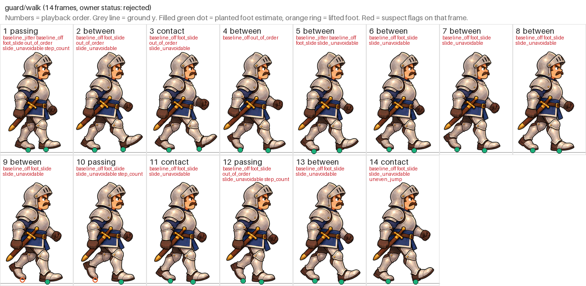
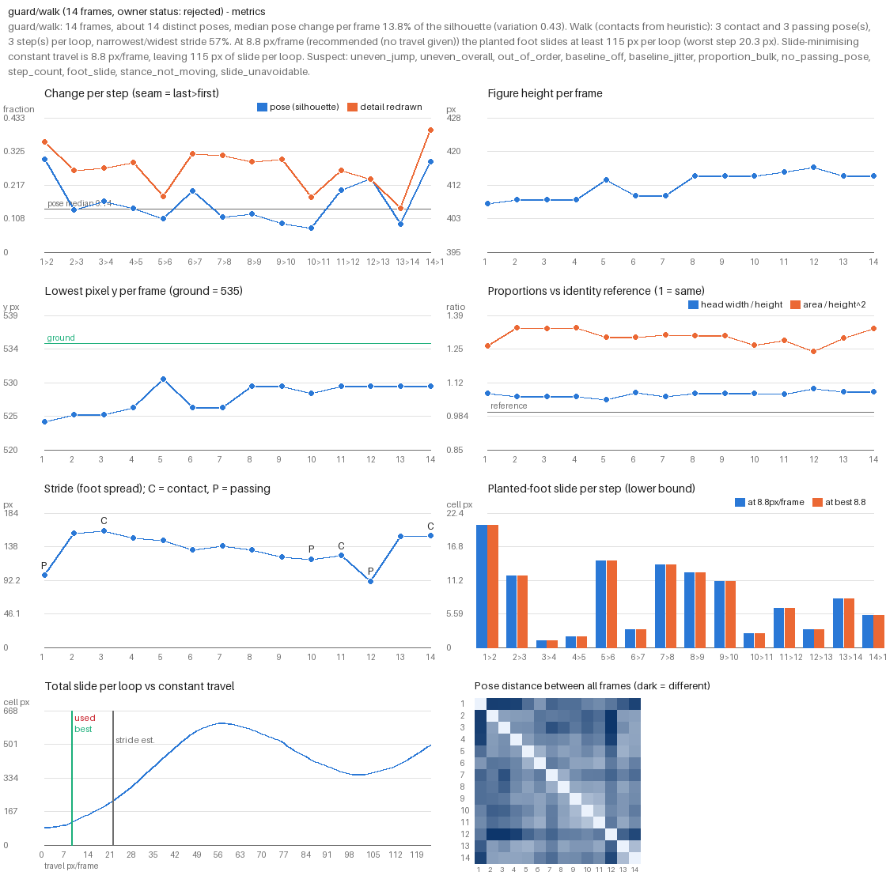
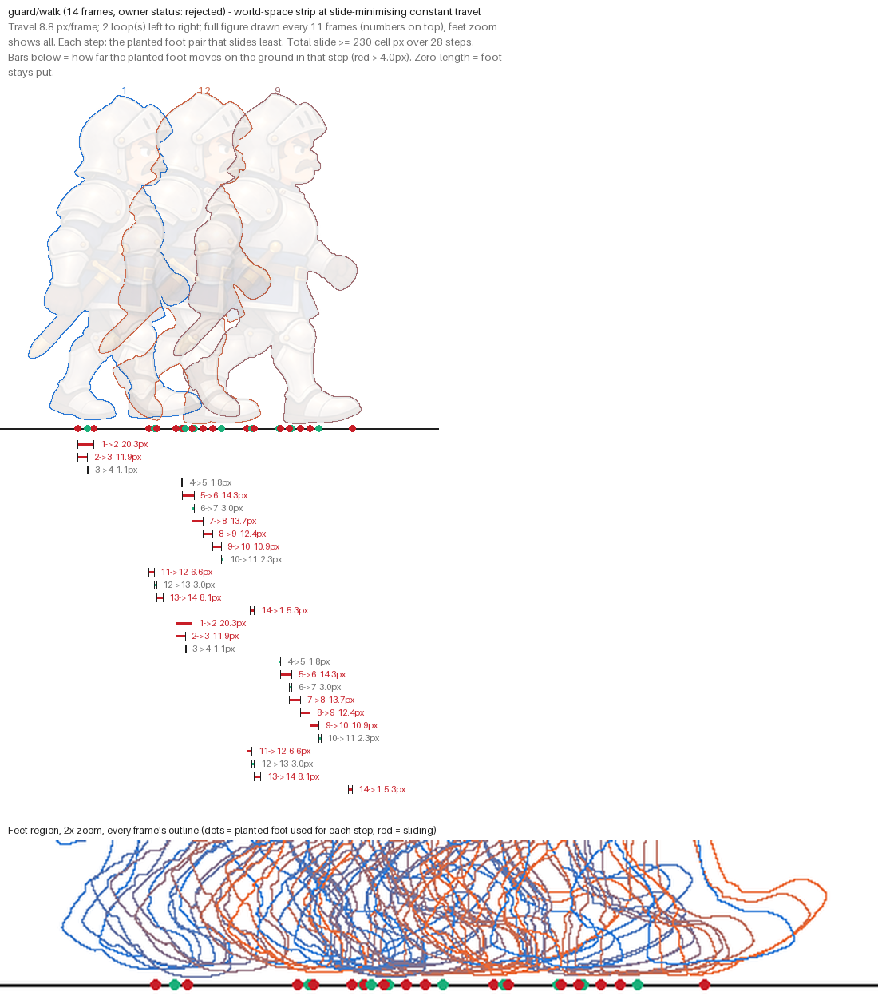

## Guard idle (rejected): "much too fast; only ~3-4 distinct drawings"

**Agrees that there are few distinct drawings. Says nothing about "too fast".**

- 9 of the 14 frames are one pose (silhouettes within 3% of each other), and in total the tool
  counts about 6 distinct poses. That is close to the earlier "~3-4" estimate; the exact number
  depends on the 3% threshold. The onion skin shows all 14 outlines almost on top of each other.
- Motion is uneven: 1→2 jumps, while 6→7, 8→9 and 9→10 barely move.
- **Limit:** "too fast" is about timing. The tool knows the frame durations only if you set them,
  and it does not judge what a good idle speed is. What it does show is that ~2.7% silhouette change
  per frame, at any frame rate, reads as jitter rather than breathing. The fix is fewer, longer-held
  drawings, and the per-frame duration editor in the workbench is where to try that.

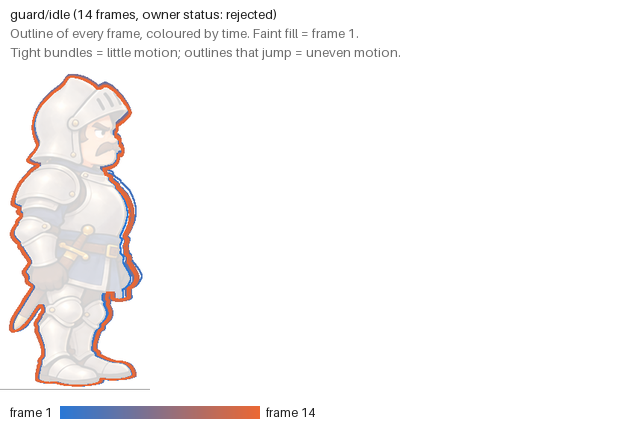
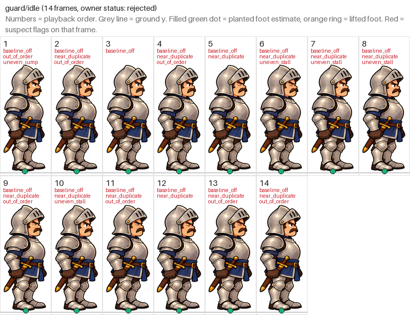
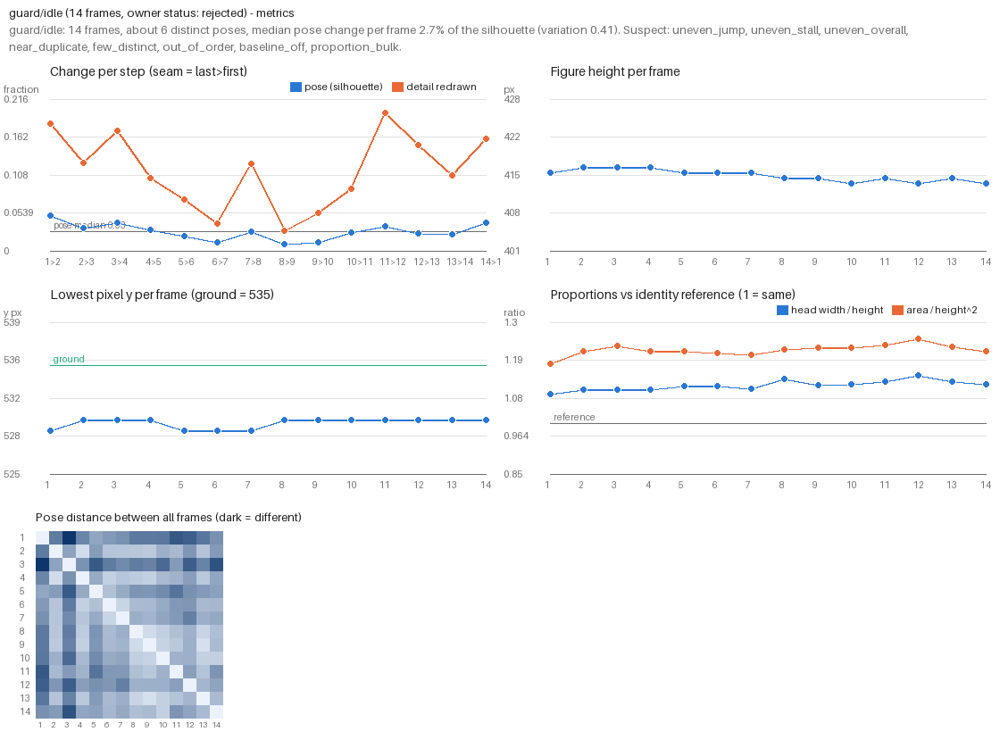

## Ren fourteen-frame walk (rejected): "uneven motion, sliding, proportions, hood/hair/colour"

**Agrees on uneven motion and sliding. Partly agrees on proportions. Does not see the colour change.**

- **Sliding.** At the old 12 px/frame the planted foot slides at least 251 px per loop, 1.5x the
  distance travelled. The worst slips come right around the passing frames: 3→4 (≥73 px), 10→11 and
  11→12. Even the best constant speed (13 px/frame) leaves 250 px, so the slipping comes from the
  drawings and changing speed cannot remove it.
- **Uneven motion.** Change per frame varies a lot (CV 0.39), and 19 frames match a non-neighbour
  better than their neighbours. The loop seam 14→1 barely moves (0.39x the median step), so the
  cycle hitches once per loop.
- **Proportions.** The head region is 1.14x wider (relative to height) than the idle reference,
  against 1.06x for the approved walk. Frames 8-14 are 2% shorter than frames 1-7, a split halfway
  through the action. That is below the 4% flag limit, but it is consistent across those seven
  frames, which suggests they were made separately.
- **Not found:** the tool sees no colour change; palette distance is the same as for the approved
  walk. Looking at the identity sheet myself, the hood is larger and more pointed, but the colours
  look the same. The figure also does not measure or look *thinner*. The manifest lists "too thin"
  among complaints about earlier generated walks, so it may not apply to this exact set.

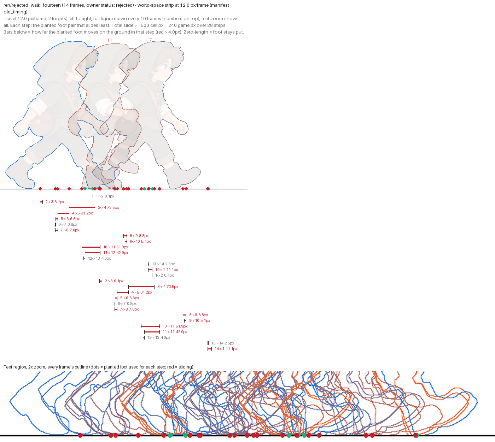
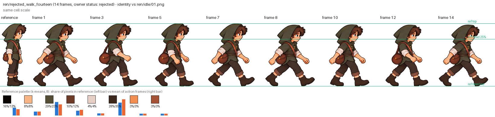
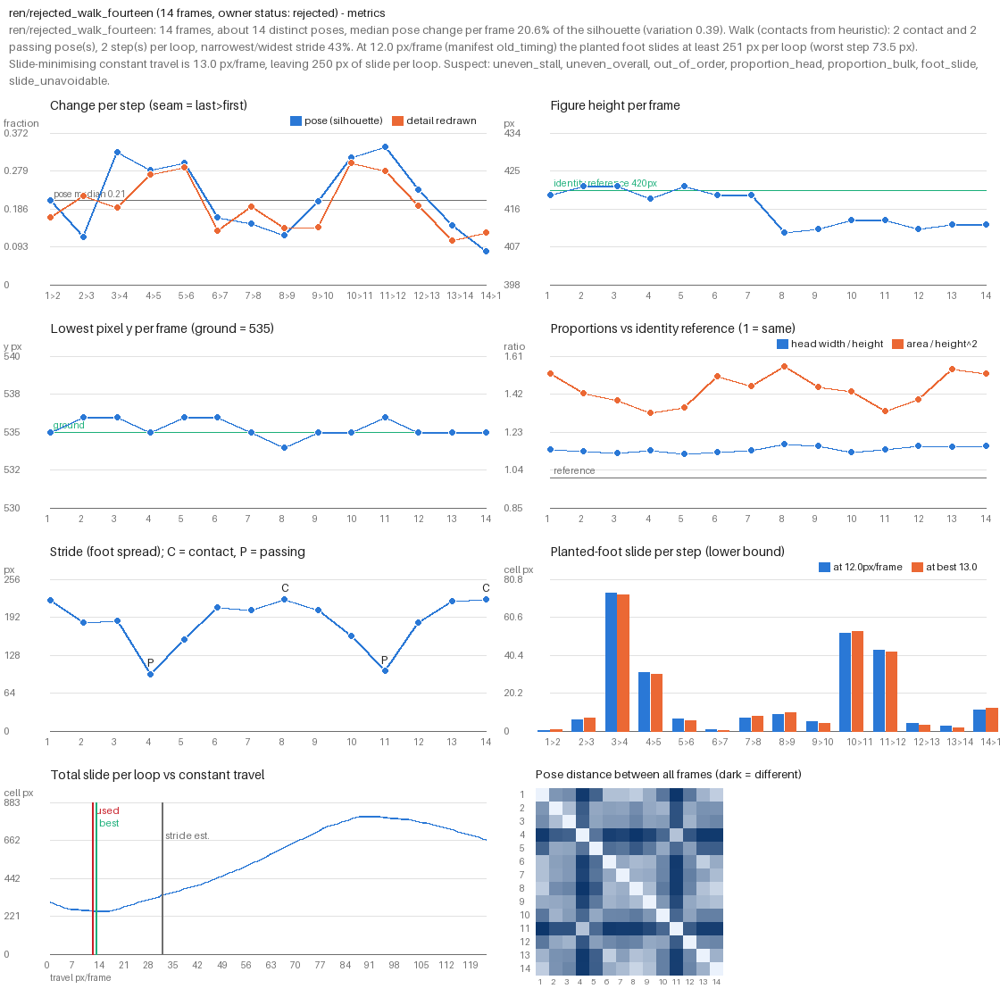

## Ren flatboy walk (rejected): "character changed and slid"

**Agrees on both.**

- **Changed character.** The head region is 1.26x the idle reference's, the largest of any action,
  and the identity sheet shows a visibly bigger head and face. It also has the most colours missing
  from the reference palette (+1.6 Lab units of error, against 0.0 for the approved walk), though
  that is a weak signal.
- **Slid.** Like the guard, its planted feet do not move backward through the cycle (least-slide
  travel 0 px/frame), so it slides at any speed: at least 320 px per loop at the old 16.7 px/frame.
  The stride collapses to a single foot cluster in frames 2-4 and 8, so the walk is a small shuffle.

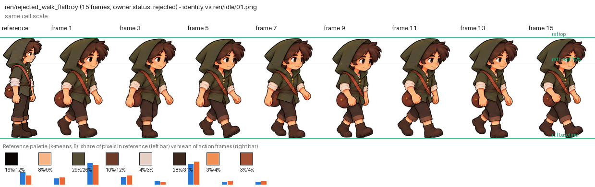
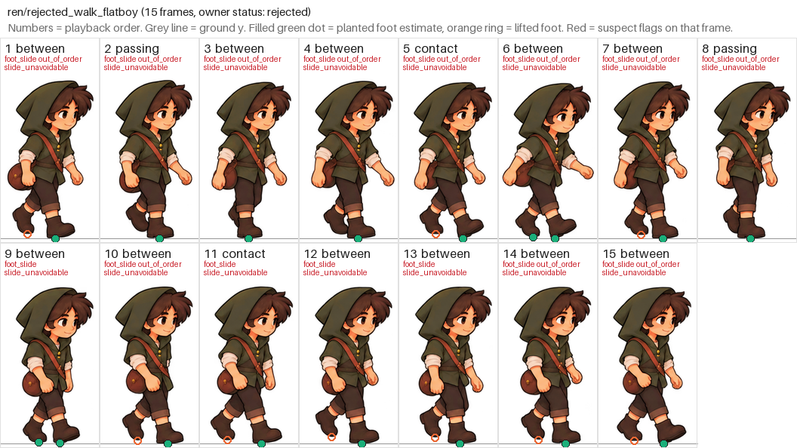
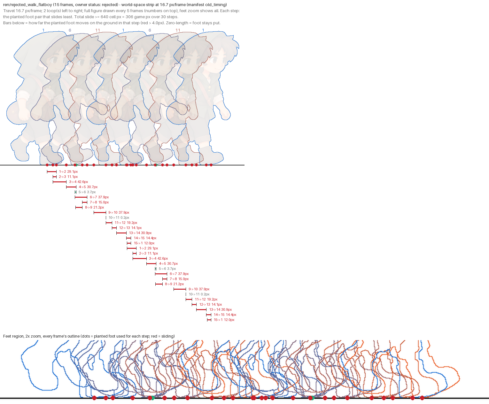

## Ren 4-pose walk (approved)

**It scores better on everything except one measure: it slides at the speed it was shown at.**

- **Better:** perfectly even change (CV 0.02), no repeated or out-of-order poses, exactly 2 steps
  with clear passing poses (stride narrows to 24%), feet that really do move backward through the
  cycle, and the closest identity match (head ratio 1.06, palette error 0.0).
- **It slides.** This is the one result the owner did not see. With heuristic contacts at the old
  demo's 41.9 px/frame, the planted foot slides at least 127 px per loop.
  To check this, I annotated contacts by hand in the workbench: the heel of the front boot at heel
  strike, the toe of the back boot at push-off, and heel and toe of the flat stance boot
  (`annotations/ren/walk_keypose.json`). With those, the drawings imply the character should
  advance **98, 70, 108 and 81 cell px** per drawing (mean 89, about 43 game px). The old demo used
  41.9 (20 game px). At that speed the annotated feet slide 189 cell px (about 90 game px) per
  loop, more than the 80 game px the character travels. The feet move backward faster than the body
  moves forward, a treadmill or moonwalk look.
- **Even spacing would not fully fix it.** The four drawings are unevenly spaced: best constant
  travel (81 px/frame) still leaves 55 px of slide per loop. Only per-drawing travel (98/70/108/81)
  makes it 0, and the moving preview confirms 0.0 px with that setting.
- **Why it might still have looked fine:** with only 4 drawings, each pose change is large (45% of
  the silhouette per frame), so slipping may be less noticeable than in 14-frame walks. And the owner
  saw it at game scale. Another possibility is that my contact points are wrong. They are my reading
  of the boots, but the heuristic, which makes no assumptions about heels and toes, gives the same
  order of magnitude: the least-slide speed is 69 px/frame, not 42.
- **What to try:** play it in the workbench's moving preview at 41.9 vs "from planted contacts" and
  let the owner judge. Note that the owner's request for in-betweens fits the old speed: the stance
  foot moves 357 cell px per cycle in these drawings, and 8 frames at 41.9 px/frame cover 335 px. So
  evenly spaced in-betweens (one between each pair of keys) could nearly remove the slide at the
  speed the owner liked. Check each new frame with the tool as it is made.

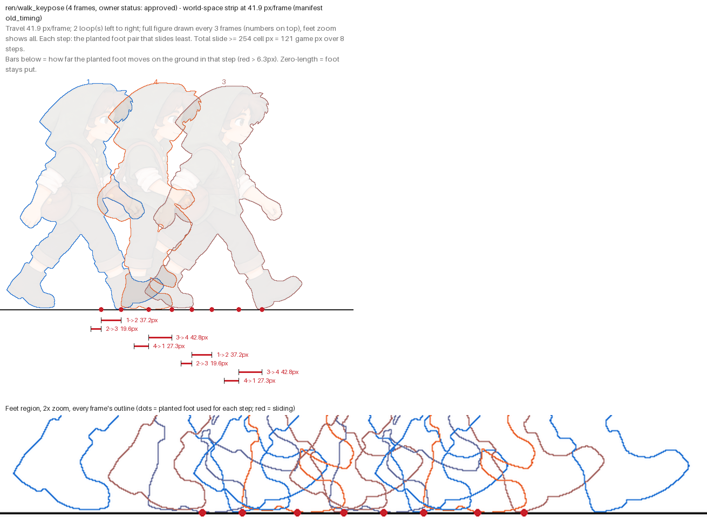
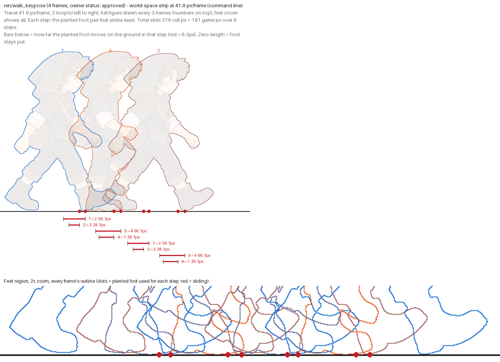
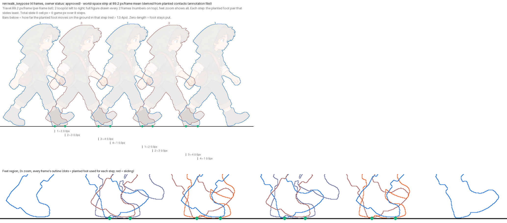

Browser (Playwright screenshots, looked at): annotated keypose moving at 41.9 px/frame shows a
28.1 px slide on step 2→3; with contact-derived travel it shows 0.0 px.

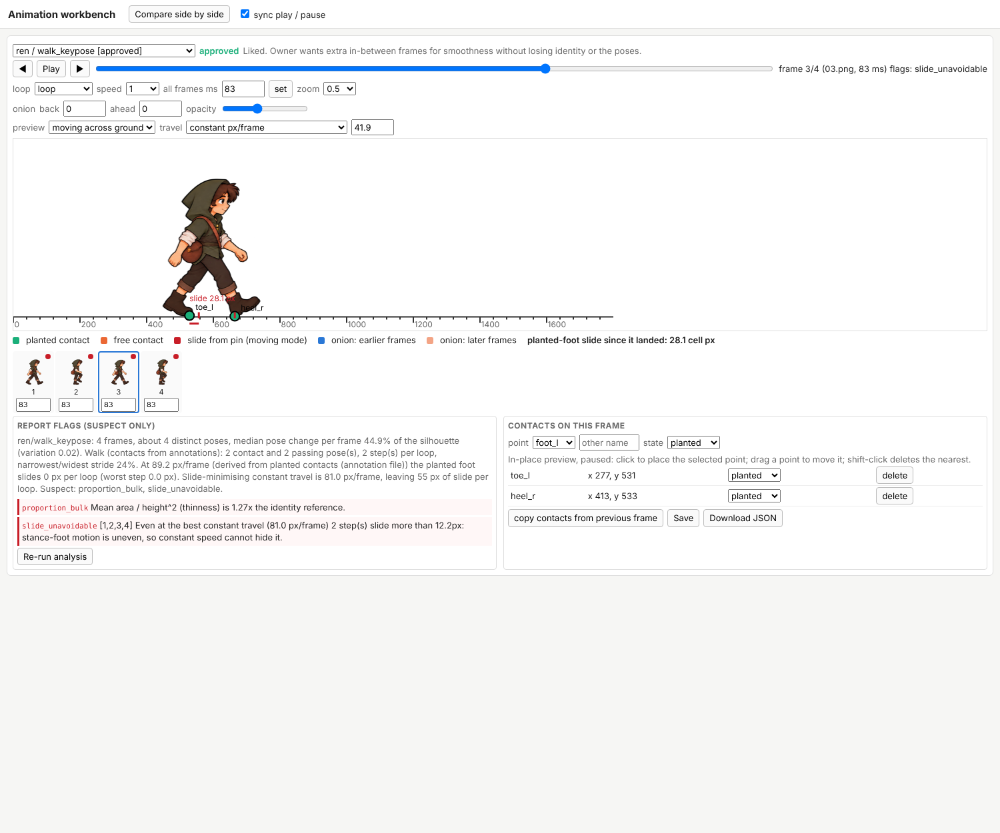
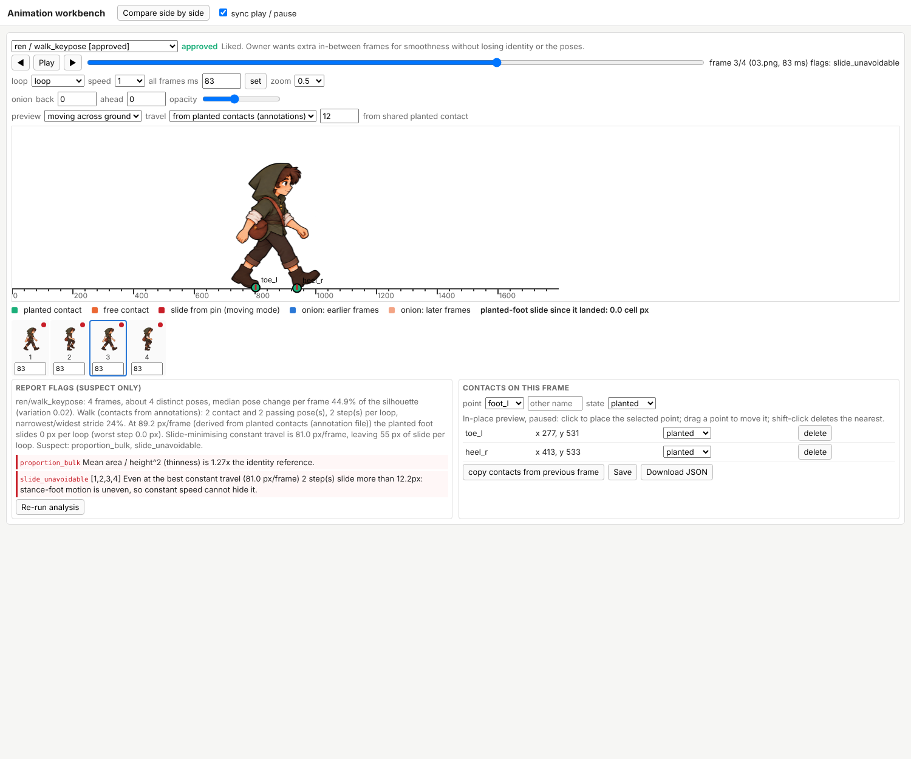

## Where the tool and the owner disagree, and why

1. **Approved walk slides.** The tool says it slides a lot at the old speed; the owner liked it.
   Possible reasons are above. I did not tune anything to make it pass.
2. **Colour drift not detected.** The palette metric (share of pixels in each of 8 reference colours)
   barely varies between actions. Either the colour changes the owner described were in other
   generated walks, or the metric is too coarse: pose changes the shares more than a slightly
   different green does. A per-region comparison (hood only, hair only) would be the next attempt.
3. **"Too thin" not detected.** Area / height² is higher for every walk than for the idle,
   including the approved one, because spread legs fill more of the box. It is not a usable thinness
   measure; compare walks with each other, not with a standing idle.
4. **"Too fast" not judged.** Timing quality is outside what the tool measures.

## Limits that matter for these results

- Heuristic feet are opaque clusters in the bottom 12% of the figure. Overlapping boots merge (the
  flatboy stride is 0 in four frames for this reason), and the contact point is the middle of the
  sole, so heel-to-toe roll reads as a few px of slide.
- Heuristic slide is a lower bound, and the travel search is limited to 0.4-1.6x a stride-based
  estimate, so for the guard and flatboy the "best" speed is the edge of that range, not a real optimum.
- Pose change is measured on silhouettes, so changes inside the outline (face, a hand in front of
  the body) count as no change. "Detail" change catches those but also counts shading noise.
- The guard's identity reference is concept art at a different size and pose, so size and proportion
  comparisons for the guard are weak.
- Only one action (Ren keypose) was annotated, by me, not by the owner.
